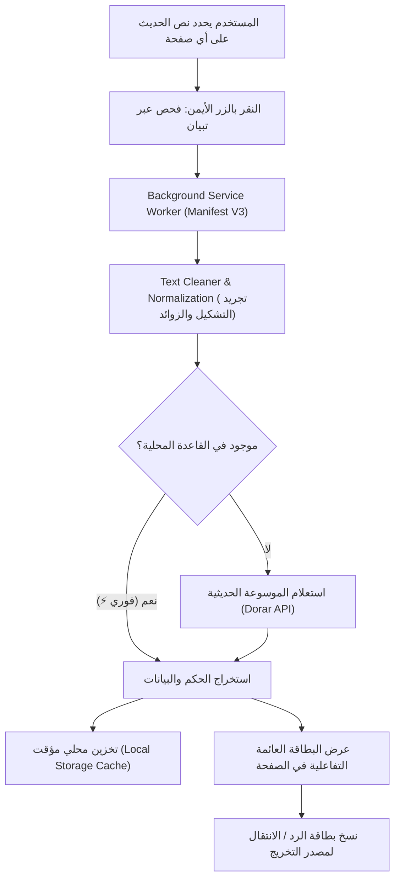

# 🔍 تِبْيَان | Tibyan - Hadith Verifier Extension

<div align="center">


### **إضافة ذكية ومفتوحة المصدر للتحقق الفوري من صحة وتخريج الأحاديث النبوية الشريفة بنقرة واحدة**
*Instant, one-click prophetic Hadith authenticity verifier and citation checker for modern browsers.*

[](LICENSE)
[](https://developer.chrome.com/docs/extensions/mv3/intro/)
[](test/test-verifier.js)
[](#-طريقة-التثبيت-والتشغيل-installation)
[](#-المساهمة-في-المشروع-contributing)

[**العربية**](#-باللغة-العربية) • [**English**](#-in-english) • [**طريقة التثبيت**](#-طريقة-التثبيت-والتشغيل-installation) • [**المعمارية التقنية**](#-المعمارية-التقنية-architecture)

---

</div>

<br/>

## 🇸🇦 باللغة العربية

### 📌 المشكلة (The Problem)
في عصر شبكات التواصل الاجتماعي (منصة X، فيسبوك، واتساب، المنتديات والمقالات):
1. **انتشار الأحاديث المكذوبة والموضوعة:** تنتشر آلاف الروايات المنسوبة زوراً أو خطأً إلى النبي ﷺ دون تثبت، مما يضلل ملايين القراء.
2. **عناء ومشقة التحقق اليدوي:** للتحقق من أي حديث يقرؤه المستخدم، عليه أن ينسخ النص، ويفتح تبويباً جديداً، ويبحث في محركات البحث أو الموسوعات، ثم يقرأ نصوصاً طويلة ومصطلحات حديثية معقدة ليتبين الحكم.
3. **صعوبة الرد والتصحيح:** عند رغبة المستخدم في تنبيه كاتب المنشور بضعف الحديث، يواجه صعوبة في صياغة بطاقة تخريج دقيقة تحتوي على اسم المحدث، والكتاب، ورقم الصفحة، ورابط المصدر المعتمد.

---

### 💡 الحل في «تِبْيَان» (The Solution)
**تبيان** هي إضافة متصفح خفيفة وسريعة وفائقة الدقة، صُممت لتختصر كل هذه المعاناة في **نقرة زر واحدة دون مغادرة الصفحة**:

1. **فحص فوري بضغطة زر (Zero-Friction Context Menu):**
   * حدد أي نص في أي موقع، اضغط زر الفأرة الأيمن واختر **«🔍 تحقق من صحة الحديث عبر تبيان»**.
2. **تصنيف لوني واضح ومريح:**
   * 🟢 **أخضر:** حديث صحيح أو حسن وثابت.
   * 🟠 **برتقالي:** حديث ضعيف أو فيه مقال.
   * 🔴 **أحمر:** حديث موضوع، مكذوب، باطل، أو لا أصل له في كتب السنة.
3. **بيانات توثيقية دقيقة ومكتملة:**
   * عرض **متن الحديث المعتمد**، **اسم الصحابي الراوي**، **المحدث**، **اسم الكتاب ورقم الحديث/الصفحة**، مع رابط مباشر لصفحة الحديث في **الموسوعة الحديثية (الدرر السنية)**.
4. **زر «نسخ بطاقة الرد» بنقرة واحدة (Viral Citation Sharing):**
   * ينسخ نصاً منسقاً واحترافياً للحديث بحكمه ومصدره، جاهزاً للصقه فوراً في التعليقات أو التغريدات لتصحيح المفاهيم ونشر الوعي.
5. **محرك هجين يعمل بدون إنترنت (Hybrid Offline/Online Engine):**
   * يحتوي على قاعدة بيانات مدمجة لأشهر الأحاديث الشائعة (المكذوبة والصحيحة) للاستجابة اللحظية في أجزاء من الثانية حتى في حال بطء أو انقطاع الإنترنت.
6. **واجهة تحكم منبثقة (Toolbar Popup):**
   * تتيح البحث اليدوي المباشر، وتجربة أمثلة شائعة، وتصفح سجل الفحص الأخير (Search History) المحفوظ محلياً بأمان.

---

<br/>

## 🇬🇧 In English

### 📌 The Problem
On modern social media platforms, forums, and articles (X/Twitter, Facebook, WhatsApp, blogs):
1. **Rampant Spread of Fabricated Narrations:** Thousands of unverified, weak (*Da'if*), or completely fabricated (*Mawdoo'*) narrations falsely attributed to Prophet Muhammad ﷺ circulate daily, misleading millions of readers.
2. **High Verification Friction:** Checking the authenticity of a hadith typically requires leaving the webpage, switching tabs, locating authentic databases, filtering complex variants, and deciphering scholarly terminology.
3. **Tedious Citation Formatting:** When users want to respectfully correct misinformation in comments, creating a complete, scholarly citation (narrator, hadith master, book reference, ruling) is cumbersome and time-consuming.

---

### 💡 The Solution: Tibyan
**Tibyan** is a lightweight, blazing-fast, and distraction-free browser extension engineered to eliminate verification friction down to **a single right-click**:

1. **One-Click In-Page Verification:**
   * Simply highlight any text on any webpage, right-click, and select **"🔍 تحقق من صحة الحديث عبر تبيان"**.
2. **Intuitive Color-Coded Verdict Badges:**
   * 🟢 **Green:** Authentic / Acceptable (*Sahih* / *Hasan*).
   * 🟠 **Amber:** Weak (*Da'if* / *Munkar*).
   * 🔴 **Red:** Fabricated / Baseless / Lie (*Mawdoo'* / *Batil* / No basis).
3. **Comprehensive Scholarly Metadata:**
   * Displays the verified hadith text, companion narrator (*Rawi*), hadith scholar (*Mohaddith*), source reference (*Book & Page/Number*), and an instant link to **Dorar.net Hadith Encyclopedia**.
4. **One-Click Formatted Citation Card Generator:**
   * Instantly copies a polished citation card to your clipboard, ready to paste in tweet replies, comments, or messaging apps.
5. **Hybrid Offline-First Architecture:**
   * Ships with an internal knowledge base of the most widespread fabricated and authentic hadiths for instant, zero-latency verification even without an active internet connection.
6. **Feature-Rich Toolbar Popup:**
   * Includes manual query search, sample queries for instant testing, and local history tracking with privacy-first client-side storage.

---

## 🏗️ المعمارية التقنية (Architecture)



---

## 🚀 طريقة التثبيت والتشغيل (Installation)

الإضافة مبنية وفق أحدث معايير متصفحات الويب (**Chrome Extension Manifest V3**) وخالية من أي حزم أو تبعيات خارجية معقدة. يمكنك تثبيتها وتشغيلها في متصفحك (Google Chrome, Microsoft Edge, Brave, Opera) في أقل من دقيقة:

### خطوات التثبيت:
1. قم بتحميل أو استنساخ المستودع (Clone):
   ```bash
   git clone https://github.com/FadySZDev/tibyan-hadith-verifier.git
   ```
2. افتح متصفحك وانتقل إلى صفحة الإضافات:
   * في **Chrome**: اكتب في شريط العناوين `chrome://extensions/`
   * في **Edge**: اكتب في شريط العناوين `edge://extensions/`
   * في **Brave**: اكتب في شريط العناوين `brave://extensions/`
3. قم بتفعيل **وضع مطور البرامج (Developer mode)** من الزاوية العلوية.
4. اضغط على زر **«تحميل حزمة غير مضغوطة» (Load unpacked)**.
5. اختر مجلد المشروع `tibyan-hadith-verifier`.
6. ✨ مبارك! ستظهر أيقونة **تبيان** في شريط أدوات متصفحك وقائمة زر الفأرة الأيمن فوراً.

---

## 📂 هيكل المجلدات (Project Structure)

```text
tibyan-hadith-verifier/
├── manifest.json              # إعدادات الإضافة وفق معيار Manifest V3
├── LICENSE                    # رخصة الاستخدام الحرة (MIT)
├── README.md                  # التوثيق الشامل (عربي وإنجليزي)
├── package.json               # بيانات المشروع وأوامر الاختبارات
├── .gitignore                 # ملف تجاهل الملفات غير الضرورية
├── _locales/                  # دعم اللغات المتعددة (عربي / إنجليزي)
│   ├── ar/messages.json
│   └── en/messages.json
├── icons/                     # أيقونات الإضافة بدقات متعددة
│   ├── icon16.png
│   ├── icon32.png
│   ├── icon48.png
│   ├── icon128.png
│   └── icon.svg
├── src/
│   ├── background/
│   │   └── service-worker.js  # إدارة القوائم والاتصال بالشبكة في الخلفية
│   ├── content/
│   │   ├── content.js         # حقن البطاقة التفاعلية داخل الصفحات
│   │   └── content.css        # التنسيقات البصرية والرسوم المتحركة
│   ├── popup/
│   │   ├── popup.html         # واجهة شريط الأدوات المنبثقة
│   │   ├── popup.css          # تنسيق واجهة البحث المنبثقة
│   │   └── popup.js           # منطق البحث اليدوي والسجل
│   └── utils/
│       ├── text-cleaner.js    # معالجة وتنظيف النصوص العربية
│       ├── offline-dataset.js # قاعدة البيانات المحلية السريعة
│       ├── verifier-engine.js # محرك التحقق وتصنيف الدرجات
│       └── card-generator.js  # مولد بطاقات الرد والمشاركة الاجتماعية
└── test/
    └── test-verifier.js       # حزمة الاختبارات الآلية (Unit Tests)
```

---

## 🧪 تشغيل الاختبارات الآلية (Running Tests)

المشروع مزود باختبارات آلية تغطي كافة دوال تنظيف النصوص، والتحقق، وتصنيف درجات الحديث، وتوليد البطاقات. لتشغيل الاختبارات:

```bash
npm test
# أو تشغيلها مباشرة عبر Node:
node test/test-verifier.js
```

---

## 🤝 المساهمة في المشروع (Contributing)

المشروع **مفتوح المصدر بالكامل** لوجه الله تعالى ونفع المسلمين. نرحب بجميع المساهمات والمقترحات:
* الإبلاغ عن أخطاء أو اقتراح ميزات عبر فتح **Issue**.
* إضافة أحاديث مشهورة جديدة للقاعدة المحلية `offline-dataset.js`.
* تحسين دقة خوارزميات استخراج الكلمات المفتاحية في `text-cleaner.js`.
* إرسال **Pull Request** بعد التأكد من اجتياز جميع الاختبارات (`npm test`).

---

## 📜 الترخيص (License)
هذا المشروع منشور تحت رخصة **[MIT License](LICENSE)** الحرة — يحق لأي شخص استخدامه وتطويره وتوزيعه بحرية.

<div align="center">
  <b>اللهم انفع به واجعله علماً يُنتفع به وصدقةً جارية</b><br/>
  <i>إذا أعجبك المشروع، لا تنسَ دعمه بنجمة ⭐ على GitHub ونشره ليعم النفع!</i>
</div>
